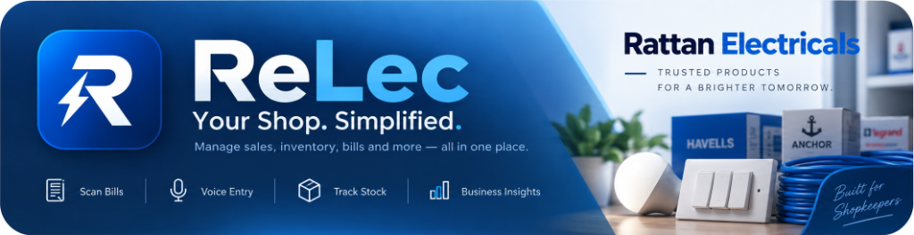
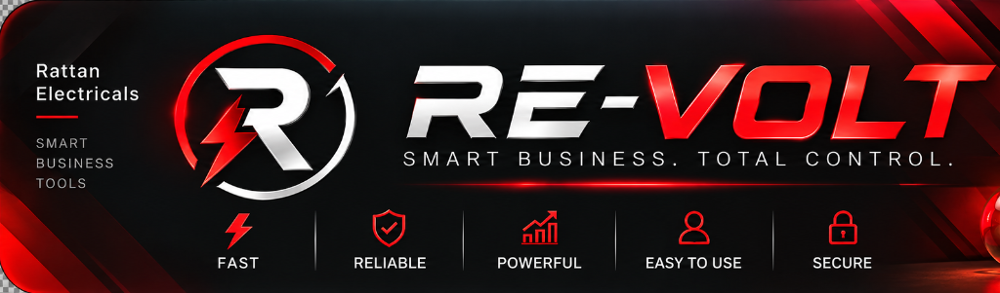

# ⚡ ReLec PRO ERP & RE-VOLT Enterprise
### Unified Dual-Brand Electrical Enterprise Management System & Public Customer Desk
#### Developed for Rattan Electricals Enterprise Traders

---

<p align="center">
  
  
</p>

<p align="center">
  <a href="https://gursimarpreetsingh-coder.github.io/relec-web-ui/"></a>
  <a href="https://gursimarpreetsingh-coder.github.io/relec-web-ui/downloads/relec-pro-erp.apk"></a>
  <a href="https://github.com/GursimarpreetSingh-coder/relec-web-ui/actions"></a>
  <a href="https://github.com/GursimarpreetSingh-coder/relec-web-ui"></a>
</p>

---

## 🌟 Quick Links & Live Deployments

| Resource | Link | Description |
| :--- | :--- | :--- |
| **🌐 Live Production Website** | [**Launch Web Portal**](https://gursimarpreetsingh-coder.github.io/relec-web-ui/) | Permanent, responsive web app with 100% feature parity |
| **📱 Android Mobile App (APK)** | [**Download `relec-pro-erp.apk`**](https://gursimarpreetsingh-coder.github.io/relec-web-ui/downloads/relec-pro-erp.apk) | Direct APK download for Android phones & tablets (v1.0) |
| **🎫 Customer Public Desk** | [**Open Customer Desk**](https://gursimarpreetsingh-coder.github.io/relec-web-ui/?view=customer) | Zero-barrier portal for customer ticket booking & tracking |
| **📂 Source Code Repository** | [**GitHub: GursimarpreetSingh-coder/relec-web-ui**](https://github.com/GursimarpreetSingh-coder/relec-web-ui) | Complete Android Native (Kotlin) + React 18 Web ERP |

---

## 📸 Visual Brand Identity & Themes

ReLec features an advanced **Dual-Brand Dynamic Switcher** allowing business operators to switch operational modes on the fly:

| Attribute | 🔷 ReLec PRO ERP (Default) | 🔴 RE-VOLT Enterprise (Power Red) |
| :--- | :---: | :---: |
| **Brand Focus** | Industrial electrical supplies, retail inventory, general repairs | High-voltage operations, emergency repairs, heavy machinery |
| **Primary Color** | Electric Cyber Blue (`#0284c7`) | Crimson Voltage Red (`#ef4444`) |
| **Logo Icon** |  |  |
| **Artwork Banner** |  |  |
| **Adaptive Launcher** | `com.example.relect.ReLecBlueLauncher` | `com.example.relect.ReVoltRedLauncher` |

---

## 🚀 Key Features & Architectural Capabilities

### 1. 🛡️ Role-Based Access Control (RBAC) & Authentication
- **Master Admin (`gursimarpsr@gmail.com` / `9872134590`):**
  - Full biometric and salted SHA-256 cryptographic credential verification.
  - **⚡ 1-Click Master Admin Instant Login** for seamless, zero-friction administrative access.
  - In-app **Password Reset & Custom Password Configuration** without lockouts.
- **Field Technician / Worker Console (`worker@relect.com` / `9821034455`):**
  - Technician attendance clock-in/out timestamping with duration tracking.
  - Job acceptance, on-site status progression, and repair notes dispatch.
- **Customer Desk (Zero-Barrier Access):**
  - Instant mobile phone OTP verification with 6-digit dispatch.
  - Direct QR Standee entry without requiring email or passwords.

### 2. 📊 Master Administrative Suite (11 Core Modules)
1. **Executive Dashboard:** Live revenue analytics, active job counts, low inventory flags, duty technician counts, and quick action bar.
2. **Service Request Dispatcher:** Comprehensive lifecycle management (`CREATED` ➔ `ASSIGNED` ➔ `IN_PROGRESS` ➔ `COMPLETED` ➔ `CLOSED`) with priority badges (`LOW`, `MEDIUM`, `HIGH`, `EMERGENCY`).
3. **Billing & GST Invoice Generator:** Professional thermal/A4 invoice printing, tax calculation, balance dues tracking, and WhatsApp sharing.
4. **Smart Inventory Manager:** Real-time catalog tracking, low-stock threshold triggers, automated restock alerts, and price margins.
5. **Customer Management:** Complete history of service repairs, ledger balances, and direct call/WhatsApp dispatch.
6. **Technician & Attendance Deck:** Duty verification, daily clock-ins, performance tracking, and role approvals.
7. **Purchase & Supplier Ledger:** Supplier bills logging, expense categorization, and stock auto-increment.
8. **Shop Expense Tracker:** Categorized store expenditures with voice-entry summaries.
9. **Financial & Analytical Reports:** Revenue distributions, category-wise breakdowns, and exportable business summaries.
10. **Store Support Desk & QR Standee Generator:** Printable counter poster generator with dynamic QR destination link customization.
11. **Team Approvals & User Permissions:** Audit logging, account activation/suspension, and security oversight.

### 3. 🤖 Multimodal AI & Voice Assistant
- **Gemini Vision OCR Scanner:** Point the device camera at physical supplier invoices or handwritten bills to instantly extract line items, quantities, and totals.
- **Electrical Component Detector:** AI visual analysis identifying motor capacitors, MCBs, contactors, relays, and circuit boards.
- **Multilingual Voice Command Engine:** Supports English, Hindi, and Punjabi voice queries (e.g., *"1.5 HP Submersible motor capacitor ka price check karo"*).

### 4. 📴 Offline-First Dual Persistence
- **Android Native:** Room SQLite database with reactive Kotlin Coroutines StateFlow.
- **Web PWA:** Dexie.js IndexedDB with real-time reactive queries (`useLiveQuery`).
- Changes persist instantly on the device and remain functional even without an internet connection.

---

## 🔑 Default Credentials & Access Guide

| Role | Login Identifier | Default Password | Access Portal |
| :--- | :--- | :--- | :--- |
| **Master Admin** | `gursimarpsr@gmail.com` *(or `9872134590`)* | `Admin@123` | Select **Admin** tab ➔ Enter credentials or click **⚡ 1-Click Instant Login** |
| **Worker / Field Tech** | `worker@relect.com` *(or `9821034455`)* | `Worker@123` | Select **Worker** tab ➔ Enter credentials |
| **Customer** | Mobile Number (e.g. `9872134590`) | *6-Digit OTP* | Select **Customer** tab ➔ Enter phone number & verify OTP |

> [!TIP]
> **Need to customize the admin password?** Click **"Set or Reset Admin Password"** on the login card to enter your preferred password at any time.

---

## 💻 Tech Stack & Architecture

```
relect/
├── app/                                # Android Native Application (Kotlin)
│   ├── src/main/java/com/example/
│   │   ├── data/                       # Room Entities, DAOs, Repository & AuthService
│   │   ├── ui/                         # Jetpack Compose Screens, ViewModels & Theme
│   │   └── util/                       # Gemini Multimodal OCR, Voice Recognition & Standee Generator
│   └── build.gradle.kts                # Android SDK 34 / Compose M3 dependencies
├── web/                                # Production Web Platform (TypeScript + React 18)
│   ├── src/
│   │   ├── data/                       # Dexie IndexedDB, Salted Cryptography & Gemini Client
│   │   ├── ui/                         # Responsive Tailwind CSS screens matching Compose M3
│   │   │   ├── sections/               # All 11 Admin Modules
│   │   │   └── components/             # AI Scanner, Voice Modal & Thermal Printer
│   │   └── types/                      # TypeScript domain models mirroring Kotlin Data Classes
│   ├── public/
│   │   ├── assets/                     # High-res logos & rectangular artwork banners
│   │   └── downloads/                  # Standalone relec-pro-erp.apk Android installer
│   └── vite.config.ts                  # Vite production bundler configured for GitHub Pages
└── .github/workflows/deploy.yml        # Automated GitHub Actions deployment pipeline
```

---

## 🛠️ Local Development & Build Commands

### Web Application
```bash
# Navigate to web directory
cd web

# Install dependencies
npm install

# Start development server
npm run dev
# Accessible at http://localhost:5173

# Compile production bundle
npm run build
```

### Android Application
```bash
# Compile debug APK
./gradlew assembleDebug

# Compile release APK
./gradlew assembleRelease
```
The generated APK is located at:
`app/build/outputs/apk/debug/app-debug.apk`

---

## 🚢 Continuous Deployment (GitHub Pages)

Every push to the `master` branch automatically triggers the GitHub Actions workflow in `.github/workflows/deploy.yml`:
1. Checks out the code and sets up Node.js 20.
2. Installs dependencies and runs `npm run build` in `/web`.
3. Deploys the compiled static website directly to GitHub Pages.

**Production Deployment URL:**
👉 [https://gursimarpreetsingh-coder.github.io/relec-web-ui/](https://gursimarpreetsingh-coder.github.io/relec-web-ui/)

---

## 📄 License & Ownership
Copyright © 2026 **Gursimar Singh** & **Rattan Electricals Enterprise Traders**. All rights reserved.
